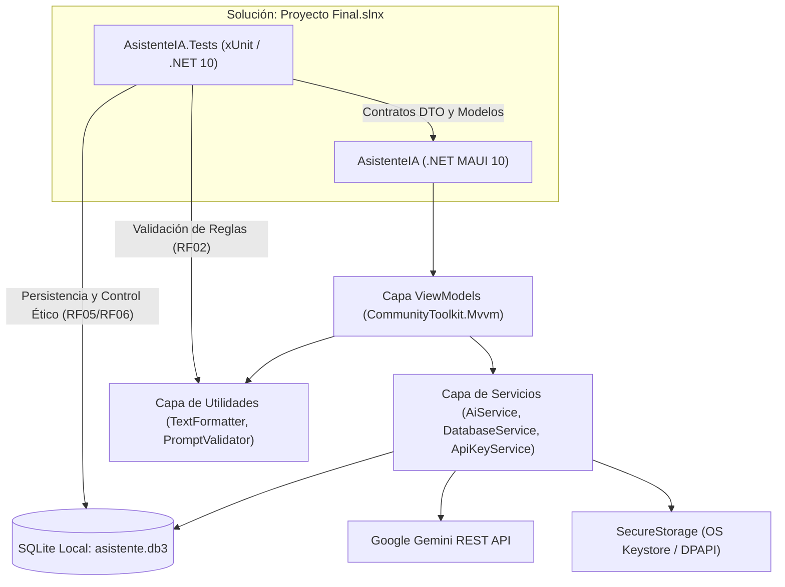

# Asistente Académico Móvil con IA (.NET MAUI) - "AsistenteIA"

Proyecto Final de **Programación Avanzada y Aplicada | VI Semestre**  
**Universidad de San Buenaventura - Bogotá**  
**Docente:** Mg. Sandra Esperanza Sánchez Barragán  
**Estudiante / Desarrollador:** Juan Rodríguez (`jdrodriguezy@academia.usbbog.edu.co`)  
**Motor de IA:** Google Gemini (Gemini 2.5 Pro / Google AI Studio API) con soporte para endpoints compatibles con OpenAI.  
**Tecnologías:** .NET MAUI 10, C# 13, XAML, MVVM (`CommunityToolkit.Mvvm`), SQLite (`sqlite-net-pcl`), xUnit, REST API.

---

## 🏛️ Arquitectura General de la Solución

La solución consta de dos proyectos complementarios organizados bajo el estándar unificado de .NET:

1. **`AsistenteIA` (.NET MAUI 10):** Aplicación cliente multiplataforma (Android, Windows, iOS, macOS) con arquitectura MVVM desacoplada, enlace de datos compilado (`x:DataType`), persistencia local encriptada/segura y componentes de formateo visual.
2. **`AsistenteIA.Tests` (xUnit / .NET 10):** Suite de pruebas unitarias automatizadas que valida la lógica de negocio, reglas de validación de prompts, transformaciones de texto y persistencia CRUD en SQLite.



---

## 🚀 Requisitos y Configuración del Entorno

1. **Visual Studio Community 2022 o superior** (v17.12+ o v18 Preview) con la carga de trabajo:
   - *"Desarrollo de la interfaz de usuario de aplicaciones multiplataforma de .NET" (.NET MAUI)*
2. **SDK de .NET 10** instalado en el sistema.
3. **Clave de API de Google Gemini:**
   - Obtenible gratuitamente desde la consola de [Google AI Studio](https://aistudio.google.com/apikey).
4. Paquetes NuGet principales configurados:
   - `CommunityToolkit.Mvvm` (v8.4.0)
   - `sqlite-net-pcl` (v1.9.172)
   - `SQLitePCLRaw.bundle_green` (v2.1.10)
   - `xunit` (v2.9.3) y `Microsoft.NET.Test.Sdk` (v17.14.1)

---

## 💻 Instrucciones de Compilación, Ejecución y Pruebas

### Ejecución de la Aplicación

#### Opción A: Desde Visual Studio
1. Abrir la solución `Proyecto Final.slnx`.
2. Establecer **`AsistenteIA`** como proyecto de inicio.
3. En la barra superior de destino, seleccionar:
   - **Windows Machine** para depuración ágil en escritorio.
   - **Android Emulator / Dispositivo Físico** para experiencia móvil.
4. Presionar `F5`.

#### Opción B: Desde la Línea de Comandos (.NET CLI)

```powershell
# Ejecutar en Windows Machine
dotnet run --project "AsistenteIA\AsistenteIA.csproj" -f net10.0-windows10.0.19041.0

# Compilar para Android (arm64)
dotnet build "AsistenteIA\AsistenteIA.csproj" -f net10.0-android -r android-arm64 -c Debug
```

---

### Ejecución de la Suite de Pruebas Unitarias Automatizadas (Fase 11)

El proyecto cuenta con **43 pruebas unitarias automatizadas** basadas en **xUnit** con un **100% de éxito (0 fallos)**:

```powershell
dotnet test "AsistenteIA.Tests\AsistenteIA.Tests.csproj" --logger "console;verbosity=normal"
```

---

## 📱 Módulos y Funcionalidades del Sistema

### 1. Inicio (`HomePage`)
- Contextualización académica del asistente potenciado por modelos de lenguaje de vanguardia (**Gemini 2.5 Pro**).
- Accesos directos a las tres áreas operativas: *Consultar IA*, *Historial* y *Configuración*.
- **Decálogo de Ética y Pensamiento Crítico:** Guía interactiva permanente para orientar al estudiante sobre el rol complementario de la IA y la prevención de alucinaciones.

### 2. Consultar IA (`ChatPage`)
- **Validación en Tiempo Real (`PromptValidator`):** Control estricto de longitud (5 a 2000 caracteres significativos, RF02) con contador de caracteres dinámico y deshabilitación preventiva de envío.
- **Banco de Plantillas Académicas Predefinidas:**
  - *Depuración de Código (Debugging & Security Review)*
  - *Optimización SQL y Modelado Relacional (3FN / Índices)*
  - *Algoritmos y Complejidad Temporal/Espacial (Notación Big-O)*
  - *Resumen Conceptual y Explicación Didáctica*
- **Motor de Formateo y Limpieza (`TextFormatter`):** Sanitizador integrado que procesa respuestas crudas de LLMs eliminando marcas de Markdown (**negrita**, *cursiva*, encabezados `###`, divisores horizontales `---`) y traduciendo notación LaTeX (`$$`, `$`, `\mathbb{Z}`) a texto en español completamente legible en controles nativos móviles.
- **Control de Asincronía y Cancelación:** Indicador de actividad visual (`ActivityIndicator`), mensaje de estado en tiempo real, bloqueo de reingreso concurrente (`IsBusy`) y botón para cancelar solicitudes en curso mediante `CancellationTokenSource`.
- **Persistencia Directa:** Botón para guardar consultas y respuestas directamente en SQLite local.

### 3. Historial Académico (`HistoryPage`)
- Lista interactiva de conversaciones almacenadas en SQLite local (`asistente.db3`).
- **Motor de Búsqueda y Filtrado Multicriterio:** Búsqueda en tiempo real por texto (en pregunta o respuesta) y filtrado por categorías temáticas (*Código*, *Bases de Datos*, *Algoritmos*, *Arquitectura*, *General*).
- **Distintivo Ético Visual:** Insignia visual diferenciada según el estado del registro:
  - ⚠️ *Pendiente de verificar con fuentes académicas* (amarillo)
  - ✓ *Verificada con fuentes confiables* (verde)
- Eliminación con cuadro de diálogo de confirmación previa.

### 4. Detalle y Verificación Ética (`DetailPage`)
- Visualización íntegra y formateada de la consulta, respuesta, fecha exacta y categoría.
- **Control Ético Interactivo:** Botón de alternancia de verificación que actualiza de inmediato el registro en SQLite, fomentando el contraste riguroso de fuentes por parte del estudiante.
- Opción de eliminación individual del registro con navegación de retorno automática.

### 5. Configuración y Diagnóstico (`SettingsPage`)
- **Gestión Segura de Credenciales:** Entrada protegida (`IsPassword="True"`) y almacenamiento seguro encriptado en el almacén del sistema operativo (`SecureStorage`), garantizando que la API Key nunca quede expuesta en código ni archivos de texto plano.
- **Selector de Modelos Gemini:**
  - `gemini-2.5-pro` (Modelo principal de razonamiento avanzado y precisión conceptual)
  - `gemini-2.5-flash` (Respuesta ultra rápida y bajo consumo)
  - `gemini-2.0-flash`, `gemini-1.5-pro`, `gemini-1.5-flash`
  - Modelos compatibles adicionales para contingencia
- **Herramienta de Diagnóstico en Vivo:** Botón *"Probar Conexión con Gemini"* que ejecuta una petición de verificación en tiempo real y reporta el estado operativo y la latencia en milisegundos.
- Gestión de borrado seguro de credenciales con confirmación.
- Declaración de privacidad y ficha técnica del proyecto.

---

## 🧪 Cobertura de Pruebas Unitarias Automatizadas (xUnit)

| Suite de Prueba | Clase | Pruebas | Cobertura Funcional |
|---|---|:---:|---|
| **Limpieza y Formateo** | `TextFormatterTests` | 13 | Limpieza de negritas, cursivas, títulos, divisores, fórmulas LaTeX en bloque y en línea, símbolos matemáticos (`\mathbb{Z}`) y normalización de espaciado. |
| **Validación de Prompts** | `PromptValidationTests` | 17 | Validación de límites inferior (5 caracteres) y superior (2000 caracteres), strings nulos/vacíos/espacios y mensajes de error orientativos (RF02 / P01). |
| **Persistencia SQLite** | `DatabaseServiceTests` | 6 | Inserción con asignación de ID primario, ordenamiento cronológico descendente, búsqueda por texto/categoría, actualización de estado ético (`IsVerified`) y borrado. Pruebas aisladas en bases de datos temporales. |
| **Modelos de Datos** | `ModelTests` | 7 | Serialización y deserialización JSON de `ChatRequest`/`ChatResponse`, propiedades calculadas de `ConversationRecord` (`ShortPrompt`, `IsPendingVerification`, `FormattedDate`). |
| **Total** | | **43** | **100% Exitosas (0 Fallos)** |

---

## 🔒 Matriz de Seguridad y Principios Éticos

- **Cero Credenciales en Código:** No existen API Keys quemadas en el repositorio. Todo acceso a servicios externos utiliza `SecureStorage` con encriptación nativa de plataforma (Android Keystore / Windows DPAPI).
- **Control Ético del Estudiante:** Sistema de verificación obligatorio que distingue visualmente entre respuestas contrastadas y respuestas pendientes de revisión crítica.
- **Minimización de Datos:** La aplicación no recopila información personal, telemetría ni credenciales del usuario; toda la persistencia es estrictamente local en SQLite.
- **Resiliencia Operativa:** Manejo robusto de errores de red (HTTP 401, 403, 404, 429, 500, 503), timeouts de 60 segundos y soporte de cancelación manual.

---

## 📋 Verificación de Casos de Prueba Institucionales (P01 - P10)

- **P01:** Consulta válida con respuesta visible y botón de guardado habilitado.
- **P02:** Validación de prompt vacío o menor a 5 caracteres sin consumo de red.
- **P03:** Manejo resiliente sin conexión / modo avión con mensaje informativo (`HttpRequestException`).
- **P04:** Manejo de clave no configurada o inválida con notificación orientativa (HTTP 401).
- **P05:** Cancelación ordenada por timeout de 60 segundos.
- **P06:** Cancelación fluida a demanda del usuario mediante botón Cancelar.
- **P07:** Inserción y persistencia efectiva en la tabla SQLite `Conversations`.
- **P08:** Eliminación de conversación con cuadro de diálogo confirmatorio.
- **P09:** Persistencia comprobada tras reiniciar o reinstalar la sesión de la aplicación.
- **P10:** Interfaz responsiva adaptable a orientación vertical/horizontal y factores de forma móvil y escritorio.
